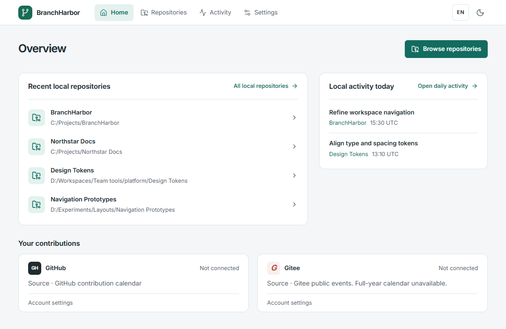

# BranchHarbor

A lightweight desktop workspace for GitHub, Gitee, and local Git repositories.

BranchHarbor started with a simple goal: bring the repositories you access on GitHub and Gitee
together with the Git repositories on your computer. One desktop workspace lets you find a
repository, open its local working tree or remote view, and pick up where you left off. It also
brings everyday Git operations, pull requests, issues, and recent activity into the same workspace.

## Project status

The repository provides a runnable Tauri/Vue application shell with Home, Repositories, Activity,
and Settings; light/dark/system appearance; local quality checks; and a cross-platform CI workflow.
The Windows title bar follows the app's appearance setting.

The desktop app connects GitHub/Gitee accounts with personal access tokens, stores credentials in
the OS credential store, and loads a paginated catalog with repository search and source filters.
The read-only repository explorer adds details, branch selection, directories, and bounded text
previews with syntax highlighting. The workspace adds expandable file trees, local commit history,
and an English or Simplified Chinese UI preference. Branches and tags can be browsed locally or
through a connected platform. Configured Git remotes support live ref listings and confirmed
deletion of a remote branch or tag. Pull requests and issues offer read-only lists, state filters,
details, paginated discussion comments, and a link to open the item in a browser. Home highlights
frequently used local and remote repositories and recent Activity across sources. Activity opens on
a chronological timeline grouped by local date, with source, repository, and activity type filters.
Settings shows the active data directory, supports relocating the SQLite databases on restart, and
offers cache cleanup. The desktop app supports local repository import, creation, cloning, changes
and diffs, staging, commits, branches, and synchronization with configured remotes. Live
private-account verification and macOS/Linux credential-store runtime checks remain outstanding; see
the [account guide](docs/provider-accounts.md). There are no signed public application releases.

Windows x64 startup, native IPC, and NSIS test packaging have been verified locally. CI is
configured for Windows x64, macOS ARM64/x64, and Linux x64. CI compilation and real installation
validation are different checks; see [validation status](docs/application-scaffold.md). The
disposable local bootstrap scripts support Windows x64 only.



## Product direction

- Connect personal GitHub and Gitee accounts, including authorized private repositories.
- Browse files, branches, commit history, pull requests, and issues.
- Import local repositories and associate them with multiple remotes.
- Create repositories, inspect changes, commit, fetch, pull, push, and manage branches.
- Browse recent local and platform activity grouped by date.
- Keep common tasks focused, with details loaded and displayed when needed.

Gitee contribution data access must be validated before promising parity with its website. See the
[product requirements](docs/product-requirements.md).

## Development

The app uses Tauri 2, Rust, Vue 3, TypeScript, Vite, Vue Router, and Lucide icons. Rust adapters use
reqwest for provider APIs, SQLite for account metadata, and keyring for OS credential storage.
Application dependencies are pinned with pnpm and Cargo lockfiles. Local repository workflows use
the installed Git CLI.

On Windows, reuse existing Git, Visual Studio C++ tools, Windows SDK, and WebView2:

```powershell
./scripts/windows/setup.ps1
./scripts/windows/dev.ps1
```

Inside the project terminal:

```powershell
pnpm install --frozen-lockfile
pnpm tauri dev
```

Run `pnpm check` for frontend/project validation and `pnpm check:rust` for Rust checks. Use
`pnpm dev` for a browser-only preview; it reports browser runtime information instead of pretending
to be the desktop application.

On Windows, run `./scripts/windows/dev.ps1 pnpm build:windows-preview` from the repository root to
generate a runnable preview in `.dev-env/target/debug/branchharbor.exe`. See the
[Windows preview build](docs/application-scaffold.md#windows-preview-build) for launch commands.

Read the [environment guide](docs/development-environment.md) first, including its cleanup and
isolation notes.

In the desktop app, open **Settings > Connected accounts > Add account**, choose the platform, and
verify a token. Then open **Repositories** to browse the joint catalog, search for a repository, or
choose a source. Browser preview disables account connections. Read the
[account guide](docs/provider-accounts.md) for token permissions, storage, recovery, and
verification limits.

Open **Repositories > Add repository** to import a working tree, initialize a repository, or clone
an existing remote in a dialog. Read the [local Git guide](docs/local-git.md) for supported
operations, remote targets, and validation.

## Documentation

Start with the [application scaffold guide](docs/application-scaffold.md) for commands, screenshots,
implemented behavior, and validation limits.

| Document                                                   | Purpose                                                               |
| ---------------------------------------------------------- | --------------------------------------------------------------------- |
| [Product requirements](docs/product-requirements.md)       | Scope, workflows, UI principles, and acceptance criteria              |
| [Architecture](docs/architecture.md)                       | Proposed technology, boundaries, and data model                       |
| [Provider accounts](docs/provider-accounts.md)             | Account setup, repository discovery, security, and validation         |
| [Repository explorer](docs/repository-explorer.md)         | Branch selection, pinned directory browsing, and text previews        |
| [Local Git](docs/local-git.md)                             | Local working trees, commits, branches, and synchronization           |
| [PR and Issue reader](docs/pr-issue-reader.md)             | Discussion lists, details, comments, provider differences, and limits |
| [Contribution sources](docs/contribution-sources.md)       | Activity coverage and contribution API research                       |
| [Data and storage](docs/data-storage.md)                   | Database location, migration, cache cleanup, and recovery             |
| [Development environment](docs/development-environment.md) | Local tools, verification, and removal                                |
| [Branching and releases](docs/branching-and-releases.md)   | Branches, manual PR workflow, and planned delivery checks             |
| [Roadmap](docs/roadmap.md)                                 | Completed work and implementation stages                              |
| [Contributing](CONTRIBUTING.md)                            | Language, commits, documentation, and validation                      |

## Contributing

Use English for project documentation, source strings, commits, and PRs. Simplified Chinese UI
translations live in `src/locales/zh-CN.json`. Update affected documentation alongside code.

Feature work targets `develop`. The maintainer creates and handles PRs on GitHub's website. Read
[CONTRIBUTING.md](CONTRIBUTING.md) before making changes.

## License

BranchHarbor is licensed under the [MIT License](LICENSE). Dependencies retain their respective
licenses; see [third-party notices](THIRD_PARTY_NOTICES.md).
