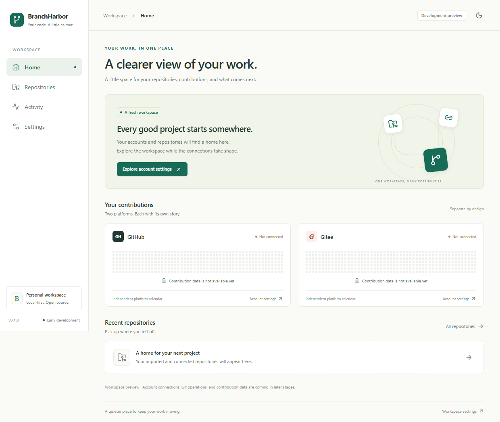

# BranchHarbor

A lightweight desktop workspace for GitHub, Gitee, and local Git repositories.

BranchHarbor is being designed to bring repository browsing, everyday Git operations, pull requests,
issues, and personal activity into a desktop interface. GitHub and Gitee contribution calendars will
be displayed separately.

## Project status

The repository provides a runnable Tauri/Vue application shell with Home, Repositories, Activity,
and Settings; light/dark/system appearance; local quality checks; and a cross-platform CI workflow.
Account connections, repository operations, and live contribution data are not implemented yet.
There are no signed public application releases.

Windows x64 startup, native IPC, and NSIS test packaging have been verified locally. CI is
configured for Windows x64, macOS ARM64/x64, and Linux x64. CI compilation and real installation
validation are different checks; see [validation status](docs/application-scaffold.md). The
disposable local bootstrap scripts support Windows x64 only.



## Planned capabilities

- Connect personal GitHub and Gitee accounts, including authorized private repositories.
- Browse files, branches, commit history, pull requests, and issues.
- Import local repositories and associate them with multiple remotes.
- Create repositories, inspect changes, commit, fetch, pull, push, and manage branches.
- View dated activity and separate contribution calendars for each platform.
- Keep common tasks focused, with details loaded and displayed when needed.

Gitee contribution data access must be validated before promising parity with its website. See the
[product requirements](docs/product-requirements.md).

## Development

The scaffold uses Tauri 2, Rust, Vue 3, TypeScript, Vite, Vue Router, and Lucide icons. Application
dependencies are pinned with pnpm and Cargo lockfiles. Git CLI integration and SQLite remain
planned.

On Windows, reuse existing Git, Visual Studio C++ tools, Windows SDK, and WebView2:

```powershell
./scripts/windows/setup.ps1
./scripts/windows/dev.ps1
```

Inside the project terminal:

```powershell
pnpm install --frozen-lockfile
pnpm tauri dev
```

Run `pnpm check` for frontend/project validation and `pnpm check:rust` for Rust checks. Use
`pnpm dev` for a browser-only preview; it reports browser runtime information instead of pretending
to be the desktop application.

Read the [environment guide](docs/development-environment.md) first, including its cleanup and
isolation notes.

## Documentation

Start with the [application scaffold guide](docs/application-scaffold.md) for commands, screenshots,
implemented behavior, and validation limits.

| Document                                                   | Purpose                                                   |
| ---------------------------------------------------------- | --------------------------------------------------------- |
| [Product requirements](docs/product-requirements.md)       | Scope, workflows, UI principles, and acceptance criteria  |
| [Architecture](docs/architecture.md)                       | Proposed technology, boundaries, and data model           |
| [Development environment](docs/development-environment.md) | Local tools, verification, and removal                    |
| [Branching and releases](docs/branching-and-releases.md)   | Branches, manual PR workflow, and planned delivery checks |
| [Roadmap](docs/roadmap.md)                                 | Completed work and implementation stages                  |
| [Contributing](CONTRIBUTING.md)                            | Language, commits, documentation, and validation          |

## Contributing

All project-authored content uses English, including comments, documentation, UI text, commit
messages, and PR titles and descriptions. Update affected documentation in the same change as
implementation.

Feature work targets `develop`. The maintainer creates and handles PRs on GitHub's website. Read
[CONTRIBUTING.md](CONTRIBUTING.md) before making changes.

## License

BranchHarbor is licensed under the [MIT License](LICENSE).
