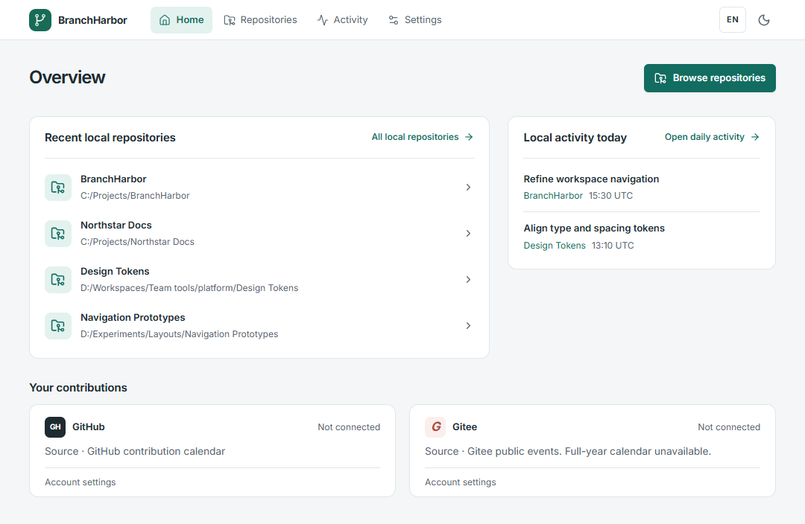
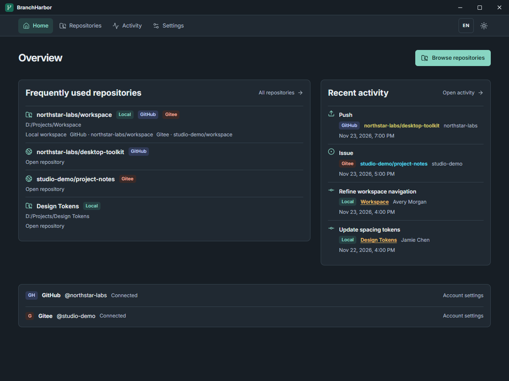
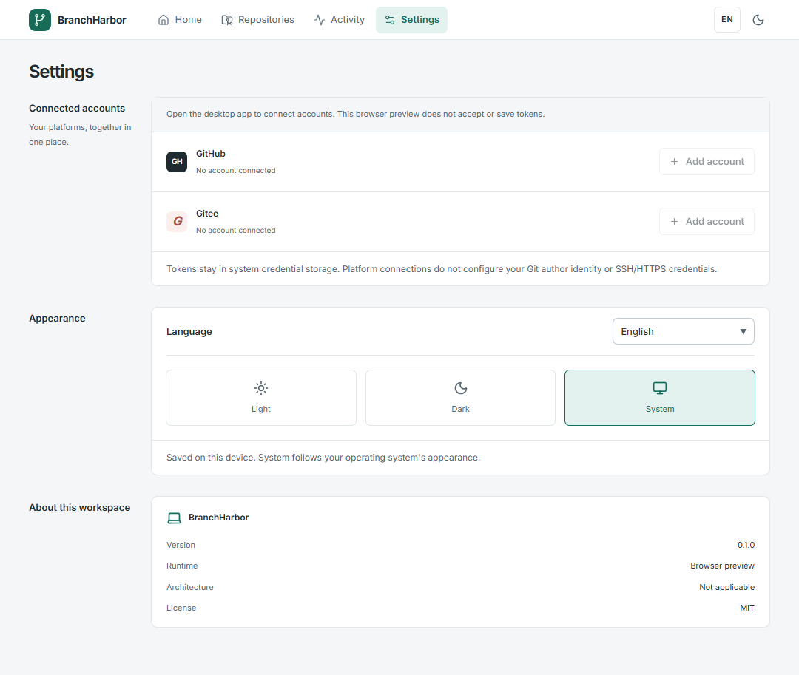

# Application scaffold

## Implemented behavior

- Home, Repositories, Activity, and Settings with hash-based navigation, history/back support, page
  titles, a skip link, and an unknown-route recovery page.
- Separate GitHub and Gitee contribution cards, recent local repositories, and local activity.
- Unconnected provider repository and activity empty states.
- Light, dark, and system appearance, persisted per device; system changes are followed in system
  mode.
- Read-only native version/platform/architecture information in Settings, with error recovery.
  Browser preview is labeled as a browser and never invents native runtime information.
- Responsive top navigation, shared design tokens, reduced-motion support, and local assets/fonts
  only.
- English and Simplified Chinese interface text, including account and repository feedback. The
  language is stored per device. Native picker buttons and chrome use the operating system's
  language.

The subsequent [provider accounts increment](provider-accounts.md) adds PAT authorization, OS
credential storage, SQLite account metadata, and paginated repository discovery. The screenshots
below show the unconnected browser preview. Automatic updates remain planned.

The [repository explorer](repository-explorer.md) adds a repository detail route, paginated branch
selection, immutable directory browsing, and bounded source previews. Its guide records the current
test counts, screenshots, limits, and live-validation requirements.

The [PR/Issue reader](pr-issue-reader.md) adds a lazy discussion route, repository task navigation,
state-filtered lists, details, and paginated general comments. Its validation record supersedes the
foundation-only test counts below. The [contribution dashboard](contribution-sources.md) adds a
GitHub calendar, a Gitee public event sample, daily activity, and cached provider data.

The [local Git workspace](local-git.md) adds desktop repository registration, changes, commits,
branches, and named-remote synchronization. Browser preview disables these native actions.

## Source layout

```text
src/
  main.ts                  # Application startup
  App.vue                  # Workspace shell
  router.ts                # Lazy routes and fallback
  styles.css / tokens.css  # Shared layout and light/dark tokens
  components/              # Reusable empty state and platform cards
  composables/appearance.ts
  composables/accounts.ts   # Shared account metadata and mutation state
  lib/accounts.ts           # Typed account and repository commands
  lib/runtime.ts           # Typed Tauri command and browser fallback
  composables/explorer.ts   # Explorer navigation and stale-response guards
  lib/explorer.ts           # Typed repository exploration commands
  workers/syntax.worker.ts  # Short-lived syntax highlighting
  views/                   # Primary views, repository explorer, and not-found page
src-tauri/
  src/lib.rs               # Tauri startup and get_runtime_info
  src/accounts/            # Provider adapters, credential service, SQLite, commands, tests
  capabilities/            # Window capability boundary
  tauri.conf.json          # Window, CSP, bundling, and identity
  Cargo.toml / Cargo.lock
tests/e2e/                 # Browser interaction and viewport checks
scripts/                   # Project consistency and PR route checks
```

## Local commands

Open the [project environment](development-environment.md), then run:

| Command                                | Purpose                                                                |
| -------------------------------------- | ---------------------------------------------------------------------- |
| `pnpm install --frozen-lockfile`       | Install pinned frontend/tool dependencies                              |
| `pnpm tauri dev`                       | Run the desktop development window and Vite server                     |
| `pnpm dev`                             | Browser-only development at `http://127.0.0.1:1420`                    |
| `pnpm check`                           | Format, ESLint, types, unit tests, language, links, and version checks |
| `pnpm check:rust`                      | Rust format, Clippy with warnings denied, and Cargo tests              |
| `pnpm build`                           | Type-check and generate frontend production assets                     |
| `pnpm build:windows-preview`           | Build the Windows debug executable with embedded frontend assets       |
| `pnpm build:windows-release`           | Build the optimized Windows executable with embedded frontend assets   |
| `pnpm tauri build --bundles nsis --ci` | Windows executable and unsigned test installer                         |

`pnpm format` writes the project's formatting. CI only checks formatting. Rust tests now exercise
account storage, credential failure recovery, and mock provider requests. Frontend and policy tests
exercise navigation, recovery, themes, native/browser separation, account state, and PR routing.
`pnpm test:credentials` is an explicit opt-in native vault round trip using one temporary synthetic
credential; it deletes that entry afterward. CI skips that test by default.

The version `0.1.0` is the scaffold's internal version, not a claim of a published release. Project
checks enforce matching npm/Cargo/Tauri versions and matching bootstrap toolchain pins.

### Windows preview build

From the repository root after setting up the Windows environment and installing dependencies:

```powershell
./scripts/windows/dev.ps1 pnpm build:windows-preview
```

The command builds the frontend and embeds it in `.dev-env/target/debug/branchharbor.exe`, which can
be opened directly with the existing WebView2 Runtime. To use the project's isolated application
data and WebView2 profile, launch through the same wrapper:

```powershell
./scripts/windows/dev.ps1 ./.dev-env/target/debug/branchharbor.exe
```

Close the preview executable before rebuilding it. The `.dev-env/` directory is ignored by Git.

Run `./scripts/windows/dev.ps1 pnpm build:windows-release` for
`.dev-env/target/release/branchharbor.exe`. Open the optimized executable in a normal Windows
session to use the release application's data and credential store. Both commands produce standalone
executables for use with WebView2. Use the NSIS command when testing installation.

### Browser checks

Build the frontend first. To reuse an existing Microsoft Edge installation on Windows:

```powershell
pnpm build
$env:PLAYWRIGHT_CHANNEL = 'msedge'
pnpm test:e2e
Remove-Item Env:PLAYWRIGHT_CHANNEL
```

Alternatively, `pnpm exec playwright install chromium` installs a project-local browser when run
inside the Windows project environment; then run `pnpm test:e2e` without the channel override. CI
installs Chromium on its disposable runner. These tests cover web behavior, not native platform
compatibility. Failure traces are written under ignored `test-results/`.

## Interface previews

The interface bundles Inter Variable and uses Microsoft YaHei UI or Noto Sans CJK SC for Simplified
Chinese glyphs. Code uses Cascadia Mono with system fallbacks. The scale uses 21–24 px for page
headings, 15 px for task headings, 13 px for body text, controls and code, and 12 px for secondary
labels. Standard control height is at least 36 px. An 8/12/16/24 px spacing scale separates
controls, panels, and pages. Light and dark themes use slate surfaces with teal for selection, green
for additions, and red for removals. Diff prefixes and selection indicators remain available in both
themes.

The desktop window opens at 1080 × 700 logical pixels and can shrink to 720 × 560. Settings has an
inset language row above the theme controls. The language menu opens when the user activates the
control. Dropdowns use the browser's select behavior with theme colors when the webview supports
customizable selects. Pages, scrollable panels, and dropdown menus share arrow-free scrollbars in
WebView2. The track is transparent, and each theme uses a translucent slate-blue thumb that gains
contrast on hover or drag. Forced-colors mode uses the system scrollbar.

The top navigation uses one row at desktop widths and two rows in narrow windows. Home puts recent
repositories first and shows today's local commits beside them when there is space. Repository rows
share a 20 px content inset with the panel heading. Each row opens its repository, with the name
above the path. The full path is available on hover. Provider summaries below the work panels lead
to Activity for the full calendar or event sample.

The layout applies the [Fluent 2 spacing guidance](https://fluent2.microsoft.design/layout),
[Impeccable](https://github.com/pbakaus/impeccable) principles for reducing visual noise, and the
[Web Interface Guidelines](https://github.com/vercel-labs/web-interface-guidelines) for long text,
keyboard focus, and responsive layout.

The Home screenshots use sample repositories and commits. Settings uses the browser preview.







## Validation record

The Windows Debug and Release executables both opened at 1080 × 700 in WebView2. Edge review
included keyboard selection in the language menu, a Simplified Chinese account error at 720 × 560,
and scrolling a commit graph with seven simultaneous lanes. The
[local Git validation record](local-git.md#storage-and-validation) covers native folder import.

Foundation Windows verification on 2026-11-02 included frontend formatting/lint/types, 24
unit/component and policy tests, 5 Edge browser tests, frontend production build, Rust checks,
native startup, embedded assets, route navigation, and the real Rust IPC response
`windows / x86_64 / 0.1.0`. Viewport checks cover 375, 720, and 1240 pixels across all four views.

The actual `tauri dev` path was also exercised: it starts Vite, compiles the native development
binary, renders the shell, and invokes Rust IPC. Vite excludes `.dev-env`, Rust files, scratch
files, and browser test output from its watcher to avoid scanning toolchains and locked profiles.

The Windows NSIS test installer was generated using the existing MSVC toolchain and project-local
NSIS cache. Official NSIS downloads required a retry and cache population with verified files on
this host. The installer is unsigned; generation and executable startup do not prove clean-machine
installation or upgrade behavior. Those checks remain release requirements.

The [CI workflow](../.github/workflows/ci.yml) is configured for Windows x64, macOS ARM64/x64, and
Linux x64. Inspect the
[actual Actions runs](https://github.com/ObsidianLoneCrane/BranchHarbor/actions) for remote results;
this local record does not claim macOS/Linux installation or runtime validation.

For the expanded test counts and account-specific validation boundaries, read the
[provider accounts record](provider-accounts.md#validation-record).
