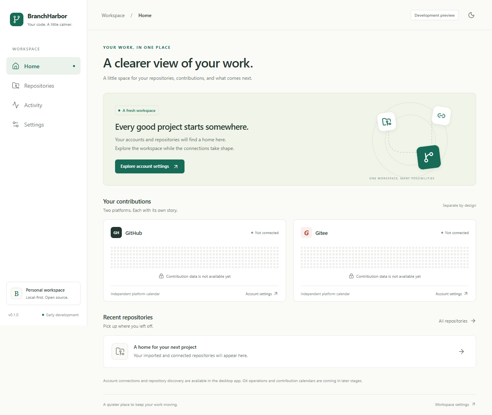
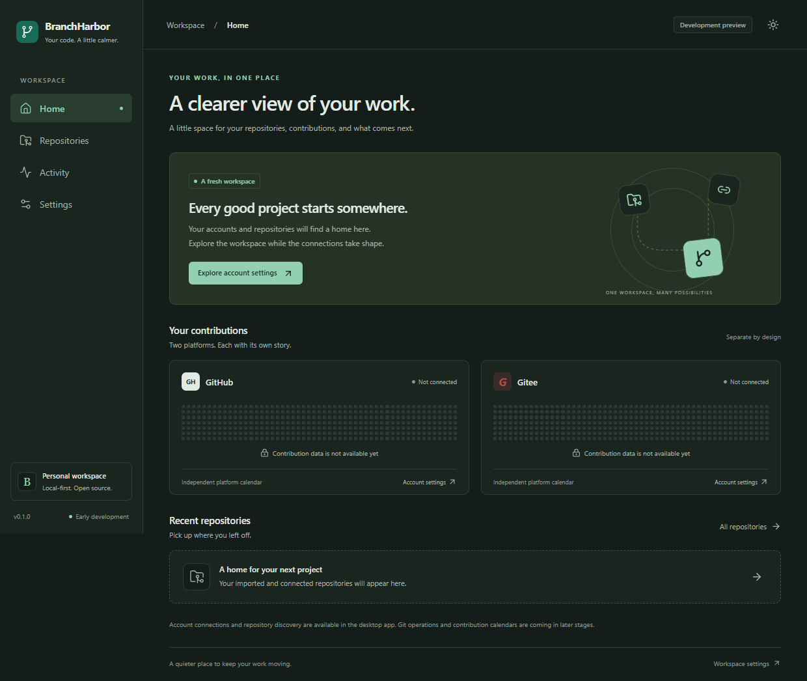
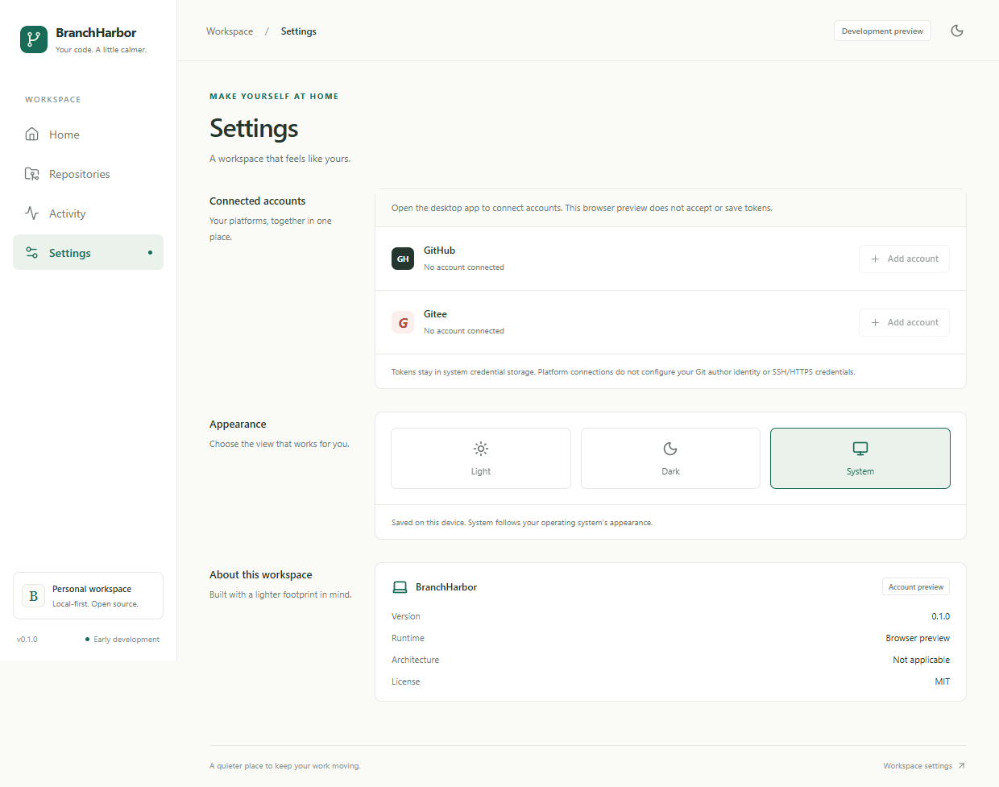

# Application scaffold

## Implemented behavior

- Home, Repositories, Activity, and Settings with hash-based navigation, history/back support, page
  titles, a skip link, and an unknown-route recovery page.
- Independent GitHub/Gitee contribution placeholders, explicitly labeled unavailable.
- Unconnected repository/activity empty states. Repository creation is disabled and explained.
- Light, dark, and system appearance, persisted per device; system changes are followed in system
  mode.
- Read-only native version/platform/architecture information in Settings, with error recovery.
  Browser preview is labeled as a browser and never invents native runtime information.
- Responsive sidebar, shared design tokens, reduced-motion support, and local assets/fonts only.

The subsequent [provider accounts increment](provider-accounts.md) adds PAT authorization, OS
credential storage, SQLite account metadata, and paginated repository discovery. Repository
mutation, contribution retrieval, and automatic updates remain planned. The screenshots below show
the unconnected browser preview.

## Source layout

```text
src/
  main.ts                  # Application startup
  App.vue                  # Workspace shell
  router.ts                # Lazy routes and fallback
  styles.css / tokens.css  # Shared layout and light/dark tokens
  components/              # Reusable empty state and platform cards
  composables/appearance.ts
  composables/accounts.ts   # Shared account metadata and mutation state
  lib/accounts.ts           # Typed account and repository commands
  lib/runtime.ts           # Typed Tauri command and browser fallback
  views/                   # Four primary views and not-found page
src-tauri/
  src/lib.rs               # Tauri startup and get_runtime_info
  src/accounts/            # Provider adapters, credential service, SQLite, commands, tests
  capabilities/            # Window capability boundary
  tauri.conf.json          # Window, CSP, bundling, and identity
  Cargo.toml / Cargo.lock
tests/e2e/                 # Browser interaction and viewport checks
scripts/                   # Project consistency and PR route checks
```

## Local commands

Open the [project environment](development-environment.md), then run:

| Command                                | Purpose                                                                |
| -------------------------------------- | ---------------------------------------------------------------------- |
| `pnpm install --frozen-lockfile`       | Install pinned frontend/tool dependencies                              |
| `pnpm tauri dev`                       | Run the desktop development window and Vite server                     |
| `pnpm dev`                             | Browser-only development at `http://127.0.0.1:1420`                    |
| `pnpm check`                           | Format, ESLint, types, unit tests, language, links, and version checks |
| `pnpm check:rust`                      | Rust format, Clippy with warnings denied, and Cargo tests              |
| `pnpm build`                           | Type-check and generate frontend production assets                     |
| `pnpm tauri build --bundles nsis --ci` | Windows executable and unsigned test installer                         |

`pnpm format` writes the project's formatting. CI only checks formatting. Rust tests now exercise
account storage, credential failure recovery, and mock provider requests. Frontend and policy tests
exercise navigation, recovery, themes, native/browser separation, account state, and PR routing.
`pnpm test:credentials` is an explicit opt-in native vault round trip using one temporary synthetic
credential; it deletes that entry afterward. CI skips that test by default.

The version `0.1.0` is the scaffold's internal version, not a claim of a published release. Project
checks enforce matching npm/Cargo/Tauri versions and matching bootstrap toolchain pins.

### Browser checks

Build the frontend first. To reuse an existing Microsoft Edge installation on Windows:

```powershell
pnpm build
$env:PLAYWRIGHT_CHANNEL = 'msedge'
pnpm test:e2e
Remove-Item Env:PLAYWRIGHT_CHANNEL
```

Alternatively, `pnpm exec playwright install chromium` installs a project-local browser when run
inside the Windows project environment; then run `pnpm test:e2e` without the channel override. CI
installs Chromium on its disposable runner. These tests cover web behavior, not native platform
compatibility. Failure traces are written under ignored `test-results/`.

## Interface previews

The following are real browser-preview captures. Placeholder calendars carry no fetched data.







## Validation record

Foundation Windows verification on 2026-11-02 included frontend formatting/lint/types, 24
unit/component and policy tests, 5 Edge browser tests, frontend production build, Rust checks,
native startup, embedded assets, route navigation, and the real Rust IPC response
`windows / x86_64 / 0.1.0`. Viewport checks cover 375, 720, and 1240 pixels across all four views.

The actual `tauri dev` path was also exercised: it starts Vite, compiles the native development
binary, renders the shell, and invokes Rust IPC. Vite excludes `.dev-env`, Rust files, scratch
files, and browser test output from its watcher to avoid scanning toolchains and locked profiles.

The Windows NSIS test installer was generated using the existing MSVC toolchain and project-local
NSIS cache. Official NSIS downloads required a retry and cache population with verified files on
this host. The installer is unsigned; generation and executable startup do not prove clean-machine
installation or upgrade behavior. Those checks remain release requirements.

The [CI workflow](../.github/workflows/ci.yml) is configured for Windows x64, macOS ARM64/x64, and
Linux x64. Inspect the
[actual Actions runs](https://github.com/ObsidianLoneCrane/BranchHarbor/actions) for remote results;
this local record does not claim macOS/Linux installation or runtime validation.

For the expanded test counts and account-specific validation boundaries, read the
[provider accounts record](provider-accounts.md#validation-record).
