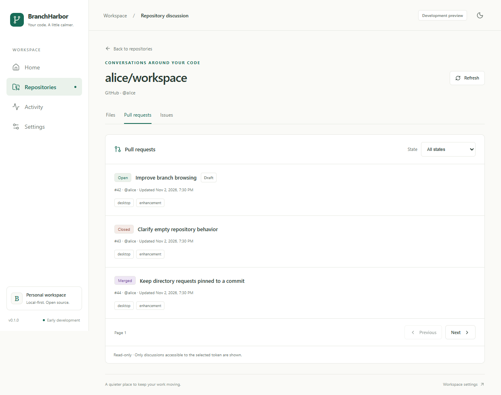
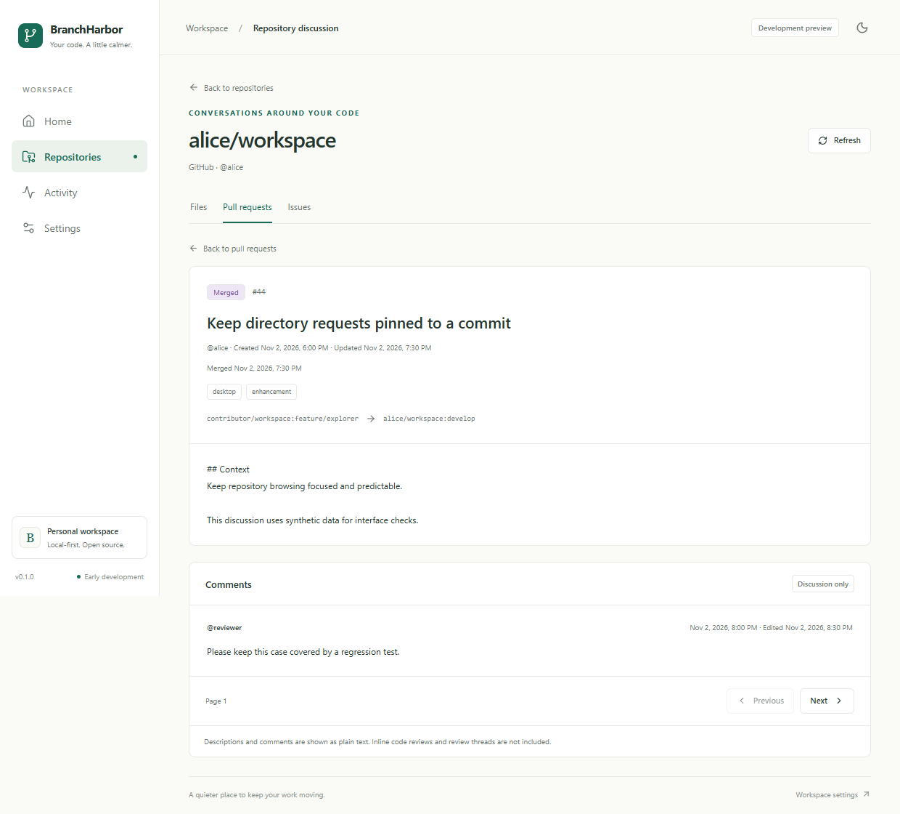
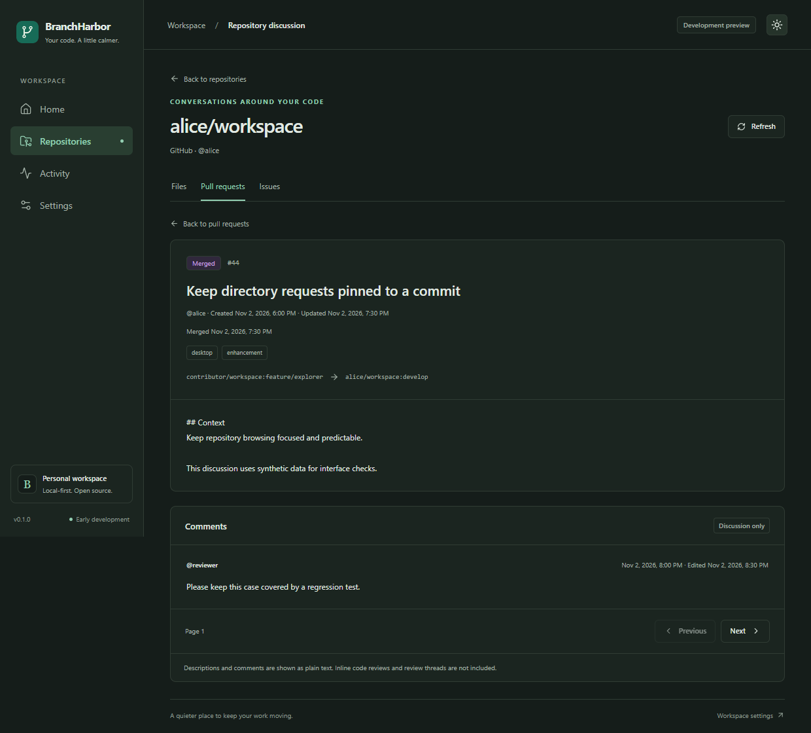
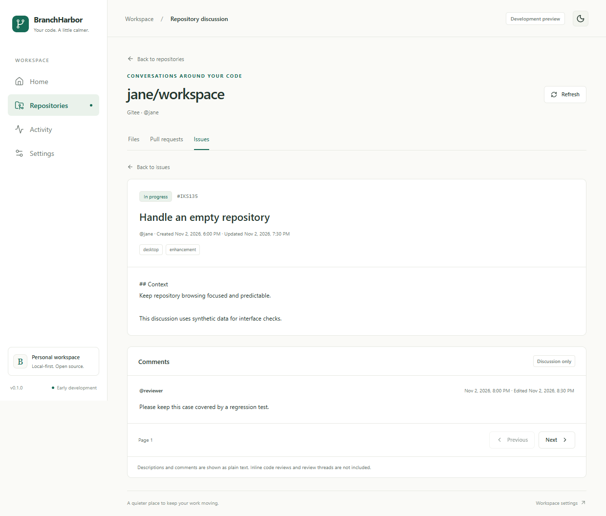

# Pull request and issue reader

Status: implemented on `feature/pr-issue-reader`. This increment adds read-only PR/Issue lists,
details, and paginated discussion comments to the repository workspace. Authenticated live-account
and private-repository validation remain pending; fixture checks do not establish authorization
coverage.

## Workflow

1. Connect a desktop account using the [account guide](provider-accounts.md), open **Repositories**,
   and select a repository.
2. Use **Files**, **Pull requests**, or **Issues** to focus on one repository task. Selecting
   another task clears the previous discussion view. Returning to Files reloads its default
   branch/root.
3. Select a state and move between provider pages. Lists show title, number, author, state, labels,
   and update time; they do not invent total repository counts.
4. Open an item to read its description and general discussion comments. PR details also show
   source/target repository and branch names where available, draft status, and closing/merge time.
   Deleted users or branches have explicit fallback labels.
5. Page comments independently. **Back to pull requests/issues** restores the list state and page;
   **Back to repositories** restores the existing in-session repository list.
6. **Refresh** rechecks the active list or reloads the active detail and current comment page.
   Comment errors preserve the readable description; **Retry** repeats the failed comments request
   without refetching an already loaded detail.

List filters, provider page, item number, and comment page are encoded in local hash routes. Browser
Back/Forward and reload restore that navigation, subject to current permissions. Bodies, tokens,
titles, and comment text are never placed in routes. The mounted reader retains one list page and
one active detail/comment page in memory; it introduces no persistent discussion cache or polling.
Times are displayed in the device's local time using English formatting.

## Provider differences

| Behavior               | GitHub                                         | Gitee                                                                            |
| ---------------------- | ---------------------------------------------- | -------------------------------------------------------------------------------- |
| PR filters             | Open, Closed, Merged, All                      | Open, Closed, Merged, All                                                        |
| Issue filters          | Open, Closed, All                              | Open, In progress, Closed, Rejected, All                                         |
| Item numbers           | Numeric strings                                | Numeric PR numbers; Issue numbers retain their original alphanumeric identifiers |
| Merged PR filtering    | Request closed PRs, then retain merged entries | Request the native merged state                                                  |
| PR discussion comments | Issue-comments endpoint for the PR number      | PR-comments endpoint with `comment_type=pr_comment`                              |
| Issue comments         | Issue-comments endpoint                        | Issue-comments endpoint with ascending order                                     |

GitHub's issue listing can contain PR entries. The adapter removes entries with `pull_request`
metadata and rejects them when opened as an Issue detail. It determines PR merge state from the
provider's merged state, merge timestamp, or explicit merged flag; ordinary closed PRs remain
distinct from merged PRs. Unknown response states are labeled Unknown.

Pagination follows the upstream page boundaries, 30 entries per request. Filtering happens after
next-page detection using `Link` metadata or the full-page fallback. A filtered page can therefore
be empty while another page exists; the UI explains this and leaves Next available. It does not
claim the repository has no matching discussions. A full final page without Link metadata can permit
one extra empty page. No unbounded scan or fabricated page count is introduced.

## Commands and transport

Repository navigation uses namespace/path components from canonical `full_name`, rather than
assuming a display name or owner login is an API path. This matters on Gitee, where friendly
repository names and namespace identities can differ from those request components.

`read_collaboration` receives a stored account ID, owner/name, `pulls` or `issues`, and one typed
operation: `list`, `detail`, or `comments`. Rust validates repository components, page bounds,
resource/state compatibility, and provider-specific item numbers before credential access. The
service reuses the selected account's OS credential and existing blocking worker/mutex boundary.

| Operation                       | Provider-relative GET path                            |
| ------------------------------- | ----------------------------------------------------- |
| PR list/detail                  | `/repos/{owner}/{repo}/pulls` and `/pulls/{number}`   |
| Issue list/detail               | `/repos/{owner}/{repo}/issues` and `/issues/{number}` |
| GitHub discussion comments      | `/repos/{owner}/{repo}/issues/{number}/comments`      |
| Gitee PR discussion comments    | `/repos/{owner}/{repo}/pulls/{number}/comments`       |
| Gitee Issue discussion comments | `/repos/{owner}/{repo}/issues/{number}/comments`      |

The adapters use the fixed GitHub/Gitee API hosts and existing header-only authorization, timeouts,
8 MiB response bound, disabled redirects, and safe error messages. Resource paths are constructed
locally; provider links are never followed. The frontend checks account, repository, resource,
operation, number, and page context. Generation guards discard late responses after switching
repositories, tasks, items, filters, or pages. Credentials remain outside frontend state.

## Safe display and recovery

Descriptions and comments are shown as escaped plain text, including Markdown source. Embedded HTML,
scripts, image URLs, and Markdown links are not rendered, executed, or fetched. Remote avatars are
not requested. This increment adds no Markdown renderer, dependencies, plugins, or write APIs.

Each description/comment is limited to 64 KiB on a UTF-8 boundary, with a visible truncation notice.
Lists omit body text; up to 100 label names are retained per item. Bodies remain transient memory
and are not written to SQLite or logs. The HTTP response bound still applies before normalization.

Loading, empty filtered pages, empty comments, inaccessible resources, expired tokens, offline
requests, locked/missing credentials, and provider errors have separate states. Comment failures are
shown inside Comments and retain the description. Rate-limit timing blocks early requests for that
account while the reader is mounted; missing timing uses 60 seconds. Navigating to another account
clears old content and uses that account's cooldown. Timers run only while a cooldown is active and
are cleared on unmount.

## Authorization and limitations

Fine-grained GitHub tokens need **Issues: read** and/or **Pull requests: read** for the
corresponding private resources. Repository **Contents: read** alone does not authorize
collaboration access. The relevant issue-comments endpoint accepts either Issues or Pull requests
read permission. Gitee tokens should include `user_info`/`projects` for account/repository access
and the relevant `issues`/`pull_requests` scopes. Scope guidance and selected
repository/organization approvals must be verified with the maintainer's actual account through the
desktop form.

This is a discussion reader: inline code review comments, review threads, diffs, review decisions,
and a complete event timeline are not included. There are no create/edit/comment/close/reopen/merge
controls. Gitee header-based authentication and live private resource coverage remain unverified, as
recorded in the account guide. A successful repository or file request does not prove discussion
permissions. A successful build is not proof of native runtime or clean installation behavior.

## Validation record

Windows checks on 2026-11-02:

- `pnpm check`: formatting, lint, types, project consistency, and 50 frontend/component/policy
  tests.
- `pnpm check:rust`: formatting, Clippy, and 33 account/provider/explorer/reader tests. The existing
  synthetic OS credential round-trip remains opt-in and ignored in ordinary CI.
- `pnpm build` and 24 Edge browser tests cover repository navigation, list/metadata restoration,
  merged/closed distinctions, Gitee identifiers/states, paged comments, safe inert bodies, filtered
  empty pages, partial errors, stale responses, cooldowns, and narrow layouts.
- Native Windows `tauri dev` verified real reader IPC, invalid inputs, missing-account recovery, and
  the Files/Pull requests/Issues navigation using isolated test data and no personal tokens.
- Windows unsigned x64 NSIS packaging succeeded using `pnpm tauri build --bundles nsis --ci`. The
  test installer is approximately 2.16 MiB. Clean installation and release-mode live-account
  behavior remain maintainer checks.

Rust mock HTTP tests exercise actual outgoing GET paths and parameters, provider normalization,
pagination before filtering, body bounds, deleted authors, mismatched resource details, and safe
error mapping. Browser fixtures live only under `tests/e2e/` and never contact providers or OS
credential storage. Public unauthenticated Gitee list responses were inspected to confirm PR branch
metadata and string Issue identifiers; this does not validate the authenticated application flow.

Inspect [current CI results](https://github.com/ObsidianLoneCrane/BranchHarbor/actions) for the
feature branch's Windows/macOS/Linux build and packaging results.

### Remaining maintainer checks

Using only the app's account form, verify public and authorized private PR/Issue lists, each
supported state, details, deleted-author cases where available, and multi-page discussion comments
for both providers. Test a restricted token and expired access. Confirm no writes occur and no
private text or token appears in screenshots/logs. Validate native behavior on macOS/Linux and clean
installation separately. Record actual token class/scopes and outcomes without secrets.

## Interface previews

These screenshots use synthetic accounts, discussions, and comments. They demonstrate the
implemented interface and do not prove live private-account authorization.

## References

- [GitHub repository issues](https://docs.github.com/en/rest/issues/issues#list-repository-issues)
- [GitHub pull requests](https://docs.github.com/en/rest/pulls/pulls)
- [GitHub issue discussion comments](https://docs.github.com/en/rest/issues/comments)
- [Gitee Open API specification](https://gitee.com/api/v5/swagger_doc.json)
