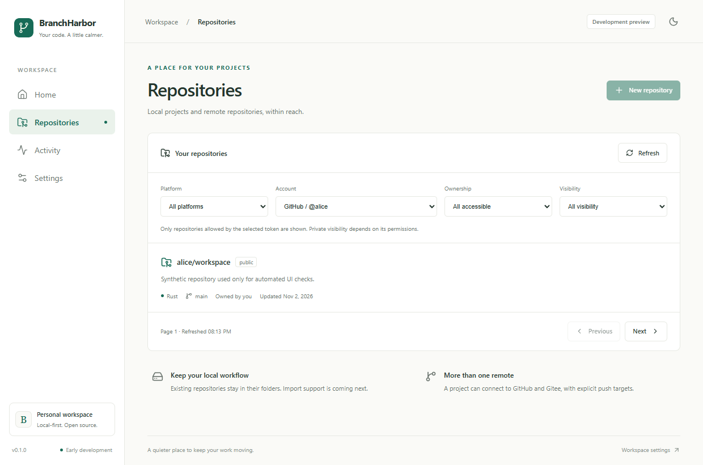
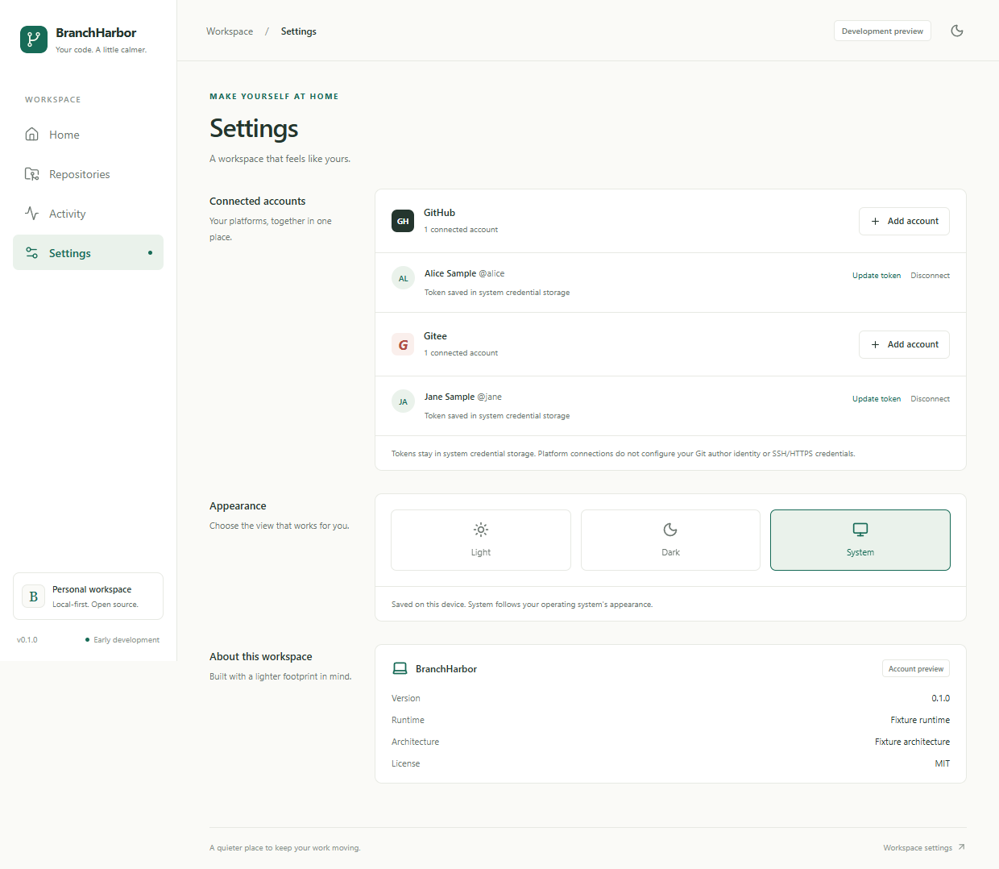
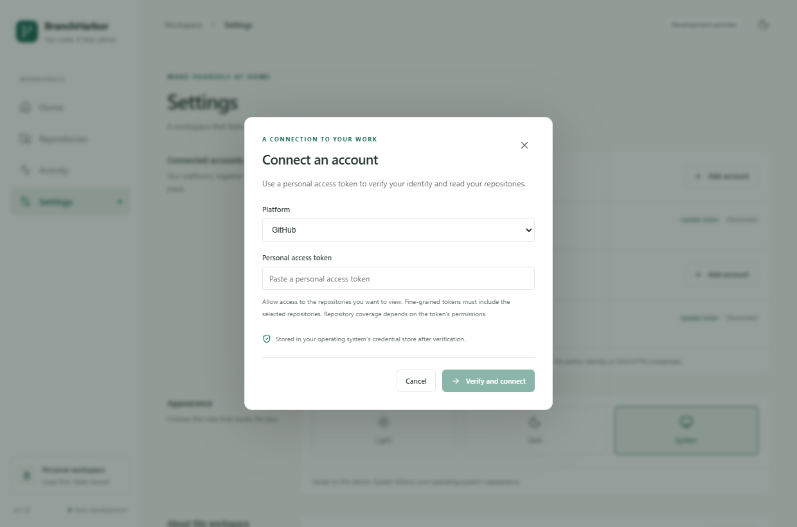

# Provider accounts and repository discovery

Status: implemented on `feature/provider-accounts`. Automated coverage and Windows native checks are
available. Live personal-account/private-repository verification and macOS/Linux credential store
runtime validation remain pending. This is the first increment of Stage 2, not completion of all
read-only browsing.

## Connect an account

1. Start the desktop app with `pnpm tauri dev` in the project environment, or use a native build.
2. Open **Settings > Connected accounts > Add account** for GitHub or Gitee.
3. Paste a personal access token and select **Verify and connect**. The app calls the provider's
   current-user API, then saves the verified identity and credential separately.
4. Open **Repositories**, choose an account, and adjust platform, ownership, or visibility filters.
5. Use **Update token** to replace an expired token for the same account, or **Disconnect** to
   remove the local connection and its saved credential. Disconnect requires inline confirmation.

Multiple accounts are supported. Reconnecting the same provider/host/user ID updates one connection;
the stable ID survives login renames. Updating an existing account rejects a token for a different
identity. API connections do not configure Git authors, SSH agents, or Git credential helpers.
Browser preview disables token entry and never calls native account commands.

## Token permissions and provider differences

Only `github.com` and `gitee.com` are supported. Enterprise/self-hosted host selection and OAuth or
device authorization flows are deferred.

| Provider | Endpoints                                              | Permission guidance                                                                                                                                                                                                              |
| -------- | ------------------------------------------------------ | -------------------------------------------------------------------------------------------------------------------------------------------------------------------------------------------------------------------------------- |
| GitHub   | `GET https://api.github.com/user`, `GET /user/repos`   | Fine-grained tokens must select the intended repository owner and repositories; organization approval can limit access. Classic tokens need `repo` for private repositories. Apply organization SSO authorization when required. |
| Gitee    | `GET https://gitee.com/api/v5/user`, `GET /user/repos` | Select `user_info` and `projects` for account and repository access; coverage depends on token permissions and memberships.                                                                                                      |

GitHub requests use API version `2026-03-10`. Both adapters send the token in an Authorization
Bearer header, never in URL query parameters. Gitee's published Swagger describes `access_token`
query parameters; the header-based authenticated path still needs verification with the maintainer's
own account. The app intentionally has no URL-token fallback. Mock tests prove the outgoing request
format, not acceptance of a real token by Gitee.

The repository list requests 30 items per page, sorted by latest update. It exposes owner,
visibility, description, language, default branch, update time, and archived status where returned.
**All accessible** includes collaboration/organization membership; **Owned by account** requests
owner affiliation. Gitee additionally includes enterprise membership. The adapters use `affiliation`
and `visibility` together without the incompatible `type` parameter.

The list is scoped to the token, not a guaranteed inventory of every repository visible on the
provider website. A successful response cannot prove that all private repositories were authorized;
the UI displays this limitation even when a request succeeds. Unknown visibility remains unknown.
There is no invented total count. `Link` metadata determines the next page where provided; otherwise
a full page enables Next, so an exact multiple can lead to one empty final page.

## Storage and recovery

SQLite stores only provider, fixed host, stable user ID, login, display name, and verification time.
The `accounts.sqlite3` database uses schema version 1 and rejects newer unsupported versions. Tokens
are stored with keyring's native credential backend: Windows Credential Manager, macOS Keychain, or
Linux Secret Service. Linux requires an available user-session Secret Service and unlocked
collection. There is no plaintext or mock fallback in production.

Release builds use Tauri's application-local data directory and credential service
`io.github.obsidianlonecrane.branchharbor.accounts`. Debug builds use
`io.github.obsidianlonecrane.branchharbor.development.accounts`; the Windows development wrapper
puts their database in the ignored `.dev-data/` directory. Without the wrapper, debug builds use a
`development` subdirectory of application-local data. Only debug builds honor
`BRANCHHARBOR_DEV_DATA_DIR`.

SQLite and the OS vault cannot share a transaction. Account operations are serialized, stage SQL
changes in a transaction, and restore the previous credential if SQL commit fails. If credential
removal fails, metadata is retained for retry. A crash between stores or a failed credential
rollback can still leave mismatched state; unlock storage and reconnect the same account to repair
it. Missing or locked credentials are labeled separately without discarding account metadata. Stored
status indicates a readable credential, not a fresh remote validation.

Tokens pass transiently through the password form and native IPC for verification, then the form
clears them after every submission or close. Rust wraps owned token strings in `Zeroizing`; this
does not guarantee erasure of JavaScript, IPC, HTTP-library, or OS copies. Tokens are not written to
frontend storage, SQLite, repository files, or application logs. Provider responses and request
errors are mapped to fixed safe messages rather than echoed. Redirects are disabled and requests
have connection/overall timeouts and an 8 MiB response bound.

Disconnect development accounts before deliberately deleting `.dev-data/`; removing metadata alone
leaves credentials in OS storage. Tool cleanup only removes `.dev-env/`, not `.dev-data/` or vault
entries. Disconnect does not revoke a provider token; revoke it through the provider's settings if
needed. Credentials and account metadata are local to each device and are not synchronized.

## Errors and interaction

- Invalid/expired tokens, permission denial, unavailable networks, malformed provider responses,
  local storage errors, and missing/locked credentials have separate messages and recovery paths.
- Rate-limit responses carry retry metadata where available. Repository Retry and Refresh respect a
  per-account cooldown while the view is mounted; without timing metadata, the UI uses 60 seconds.
- Repository filters clear old results immediately. Request identities discard late responses after
  account/filter changes or disconnection, preventing another account's results from appearing.
- Initial loading, empty authorized results, and failed requests have distinct states. Refresh is
  manual; repository pages are not persistently cached or fetched in the background.

## Validation record

Windows checks on 2026-11-02:

- `pnpm check`: formatting, lint, types, project consistency, and 31 frontend/component/policy
  tests.
- `pnpm check:rust`: formatting, Clippy, and 13 account/provider tests. The native credential test
  is ignored by default so CI does not require an unlocked user keychain.
- `pnpm test:credentials`: one real Windows Credential Manager synthetic entry was written, read,
  deleted, and confirmed absent. No production token was used.
- `pnpm build` and 10 Edge browser tests: dual-platform metadata, failed/successful connection,
  pagination, filters, reload, confirmed/cancelled disconnect, rate limits, stale responses, and
  responsive layouts. These use explicit test-only IPC fixtures, not live provider accounts.
- Native `tauri dev`: real Windows Settings form, token clearing, SQLite initialization, and
  account/repository IPC were exercised using an isolated database and invalid synthetic input.
- `pnpm tauri build --bundles nsis --ci`: Windows release executable and unsigned x64 NSIS test
  installer generated successfully (approximately 2.07 MiB). Clean installation remains untested.

Rust mock HTTP tests cover provider-specific parameters, header-only authentication, pagination,
ownership/visibility mapping, safe error classification, and disabled redirects. Service tests cover
stable identities, metadata persistence without tokens, vault failures, and credential rollback
after SQL commit failure. Browser fixtures exist only in `tests/e2e/`; production adapters have no
configurable mock endpoints.

The existing four-target CI checks compilation, tests, and test packaging. A successful CI build
does not prove native keychain behavior or clean installation. Inspect the
[current Actions results](https://github.com/ObsidianLoneCrane/BranchHarbor/actions) for this
branch.

### Maintainer verification still required

Use tokens only through the desktop app; never put them in chat, screenshots, commands, or fixtures.
For each provider, connect a real account, verify a known public and authorized private repository,
restart and confirm metadata/credential restoration, update the token, then disconnect and check
credential removal. Exercise restricted scopes, expiry, and organization approval where applicable.
Repeat native persistence/removal checks on macOS and Linux with their actual credential stores.
Record platform, token class/scopes, repository visibility, and outcome without recording secrets.

Acceptance for live private-account coverage remains open until those checks are recorded. File
trees, revision selection, branches, PR/issue details, local import, Git mutations, and contribution
calendars remain later increments. Gitee full-year contribution coverage is still unresolved.

## Interface previews

These screenshots use synthetic account/repository fixtures from the browser test suite. They
illustrate the implemented interface and do not demonstrate live provider authorization.

## References

- [GitHub authenticated user](https://docs.github.com/en/rest/users/users#get-the-authenticated-user)
- [GitHub repositories for the authenticated user](https://docs.github.com/en/rest/repos/repos#list-repositories-for-the-authenticated-user)
- [Gitee Open API Swagger](https://gitee.com/api/v5/swagger)
- [Gitee machine-readable specification](https://gitee.com/api/v5/swagger_doc.json), inspected as
  version 5.4.93 on 2026-11-02
- [keyring native credential API](https://docs.rs/keyring/latest/keyring/v1/struct.Entry.html)
