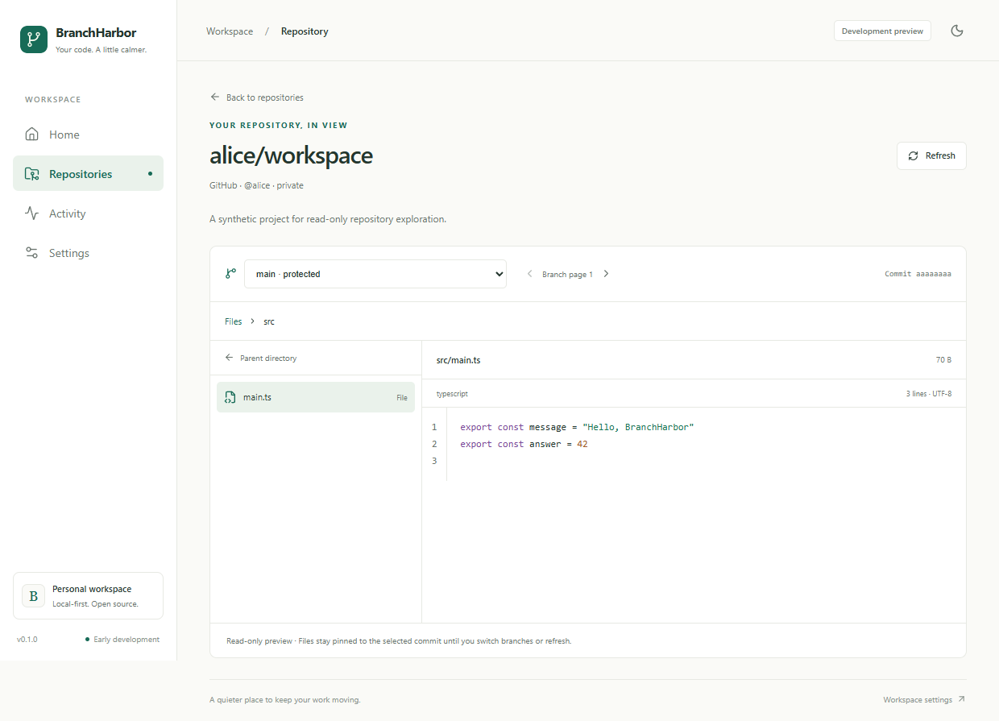
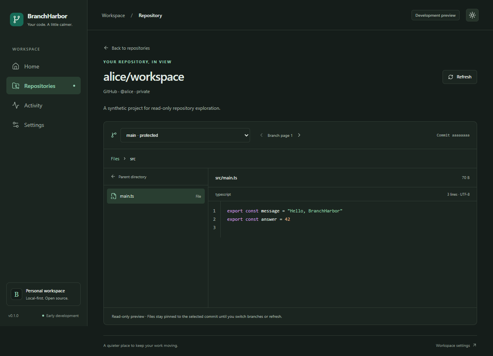

# Repository explorer

Status: implemented on `feature/repository-explorer`. The explorer adds read-only details, branch
selection, directory browsing, and text previews to the existing account-scoped repository list.
Live authenticated/private-repository checks remain pending; automated fixtures do not establish
provider authorization coverage.

## Use the explorer

1. Connect an account in the desktop app using the [account guide](provider-accounts.md).
2. Open **Repositories**, select an account, and click a repository name.
3. The explorer loads repository metadata and the first branch page, then resolves the default
   branch (or the first available branch) to its current commit and root tree.
4. Choose a branch, open a directory, or select a text file. Use the path breadcrumbs or **Parent
   directory** to navigate upward. The branch selector has independent page controls, 30 entries per
   page; a selected branch remains visible when it is outside the current branch page.
5. **Refresh** reloads metadata and the selected branch at its latest commit, returning to the root.
   **Back to repositories** restores the in-session list account, filters, and page. Reloading the
   app does not preserve explorer navigation or list filters.

The layout focuses on a branch selector, directory entries, and one file preview. At narrow widths,
the directory and file panes stack. Repository descriptions and names remain escaped text. This
increment has no file editor, downloads, rendered Markdown, commit-history view, or Git mutations.

## Revision and request boundaries

The typed `explore_repository` command accepts a stored account ID, repository owner/name, and one
operation: `detail`, `branches`, `branch`, `directory`, or `file`. Rust validates inputs before
credential access, reads the selected account's OS credential, and performs blocking work on Tauri's
worker pool using the existing serialized account service. Tokens never enter routes or caches.

| Operation | Provider-relative GET endpoint                      | Result                                                           |
| --------- | --------------------------------------------------- | ---------------------------------------------------------------- |
| Detail    | `/repos/{owner}/{repo}`                             | Identity, description, visibility, default branch, archive state |
| Branches  | `/repos/{owner}/{repo}/branches?page=N&per_page=30` | One branch page and next-page availability                       |
| Branch    | `/repos/{owner}/{repo}/branches/{encoded-branch}`   | Immutable commit SHA and root tree SHA                           |
| Directory | `/repos/{owner}/{repo}/git/trees/{tree-sha}`        | Nonrecursive directory entries                                   |
| File      | `/repos/{owner}/{repo}/git/blobs/{blob-sha}`        | Bounded, decoded text or an explicit unsupported state           |

GitHub uses `https://api.github.com`; Gitee uses `https://gitee.com/api/v5`. Both share the existing
header-based transport, fixed hosts, timeouts, disabled redirects, and safe error mapping. Owner,
repository, and branch components are encoded independently. Slash-containing branch names remain
one encoded component. Tree/blob references must be full hexadecimal SHA-1 or SHA-256 IDs. The app
never follows API response URLs or pagination links, invokes Git, or writes fetched files locally.

Directories and blobs are addressed by immutable object IDs from the selected revision, not by
re-reading a moving branch for every click. Updating a remote branch does not silently change an
open preview. Request generations discard late responses after branch, directory, repository, or
route changes. The native boundary also checks account/repository/operation response identity. Views
clear old source before loading another target.

## Limits and file handling

- Branches load 30 at a time. `Link` metadata determines the next page when present; a full-page
  fallback may permit one empty final page.
- Directory requests are nonrecursive, with an 8 MiB response bound. At most 2,000 sorted entries
  are returned to the UI. Provider truncation or the application cap displays an incomplete-list
  warning; there is no fabricated continuation mechanism for the tree endpoint.
- File previews allow 256 KiB and 5,000 display lines. Known oversized entries skip the blob fetch;
  otherwise the JSON body is bounded to 384 KiB before parsing. Oversized responses produce a
  preview limit state. Base64 decoding validates object identity and declared byte length.
- UTF-8 text is supported; a leading BOM is removed and CRLF/CR line endings normalize to LF for
  display. Empty files, binary/control-byte content, unsupported encodings, and oversized files have
  distinct explanations. No encoding detection or conversion is attempted.
- Symbolic links and submodules are labeled and do not trigger target traversal or another
  repository request. Unknown entry types cannot be previewed.
- A lazy-loaded highlight.js core supports JavaScript, TypeScript, Rust, Python, JSON, CSS,
  XML/HTML/Vue, and shell source. Other extensions display plain text. Highlighting runs in a
  short-lived module worker and falls back to escaped text if it fails or exceeds two seconds.
  Generated highlight markup is the only HTML inserted into the preview; raw provider content is
  never rendered as HTML. Workers terminate on completion, replacement, or unmount.

The pinned highlighter adds no hosted fonts, CDN scripts, or services. Its notice is included in
[third-party notices](../THIRD_PARTY_NOTICES.md) and mapped into native bundle resources. Original
BranchHarbor source remains MIT-licensed.

## Recovery

Loading, empty repositories, missing/inaccessible resources, expired tokens, locked or missing
credentials, offline/provider failures, and truncated directories are separate states. Retry keeps
the failed operation's context. Rate-limit cooldowns apply per account while the explorer is
mounted; Refresh, Retry, branch selection, and directory/file requests respect the cooldown. No
background polling or durable source cache is introduced. Repository metadata or source already
shown in a session is not proof of current server permissions; refresh to recheck access.

Fine-grained GitHub tokens need repository **Contents: read** permission for branches, trees, and
blobs, in addition to access to the intended repositories. Listing a repository successfully does
not establish permission to read its files. Gitee still requires live verification of the chosen
authorization path and private-repository access; do not claim equivalent authorization coverage
from the common endpoint shape.

## Validation

Windows validation on 2026-11-02:

- Frontend quality checks and 40 frontend/component/policy tests.
- Rust formatting, Clippy, and 23 account/provider/explorer tests; the existing OS credential
  round-trip test remains opt-in and ignored in ordinary CI.
- Frontend production build and 16 Edge browser tests, including real syntax workers with explicitly
  synthetic IPC fixtures.
- Windows `tauri dev` startup and real `explore_repository` IPC validated missing accounts and
  invalid targets. A synthetic source preview highlighted successfully in the native WebView.
- `pnpm tauri build --bundles nsis --ci` generated the Windows release executable and unsigned x64
  installer (approximately 2.13 MiB), including the mapped third-party notice. Clean installation
  and release-mode preview behavior remain maintainer checks.

Coverage includes response isolation, stale branch/repository/file requests, immutable revision
selection, slash branch encoding, nonrecursive trees, pagination, truncation, file bounds,
credentials, safe source display, empty repositories, recoverable failures, list restoration, and
narrow layouts. Browser fixtures live only under `tests/e2e/` and never contact real providers or
the OS vault. Rust mock servers exercise actual outgoing request paths and JSON normalization.

The public Gitee `oschina/git-osc` branch endpoint was inspected without authentication to confirm
its nested commit/tree response shape, which its Swagger describes incompletely. That probe does not
validate a personal token or the full authenticated application workflow.

Use the [current Actions runs](https://github.com/ObsidianLoneCrane/BranchHarbor/actions) to inspect
this branch's four-target build/package results. Native keychain behavior, private authorization,
clean installation, and macOS/Linux runtime behavior still require target-specific validation.

### Maintainer acceptance checks

For each provider, use the app's account form to authorize a real account, open known public and
private repositories, browse a nested directory and UTF-8 file, switch a slash-containing branch,
refresh after a remote update, and recover from a removed branch or restricted scope. Confirm the
displayed commit stays fixed while browsing and changes only after branch selection or refresh. Keep
tokens and private source out of screenshots and logs. Repeat native preview/worker behavior on
macOS and Linux before claiming runtime parity.

PR/issue reading is the next focused increment. Local import, Git mutations, full history, tags, and
contribution calendars remain separate roadmap work.

## Interface previews

These light/dark screenshots use synthetic account, revision, and source data. They demonstrate the
implemented layout, not live private-repository access.

## API references

- [GitHub branch endpoints](https://docs.github.com/en/rest/branches/branches)
- [GitHub Git trees](https://docs.github.com/en/rest/git/trees)
- [GitHub Git blobs](https://docs.github.com/en/rest/git/blobs)
- [Gitee Open API specification](https://gitee.com/api/v5/swagger_doc.json)
- [highlight.js modular usage](https://highlightjs.org/#usage)
